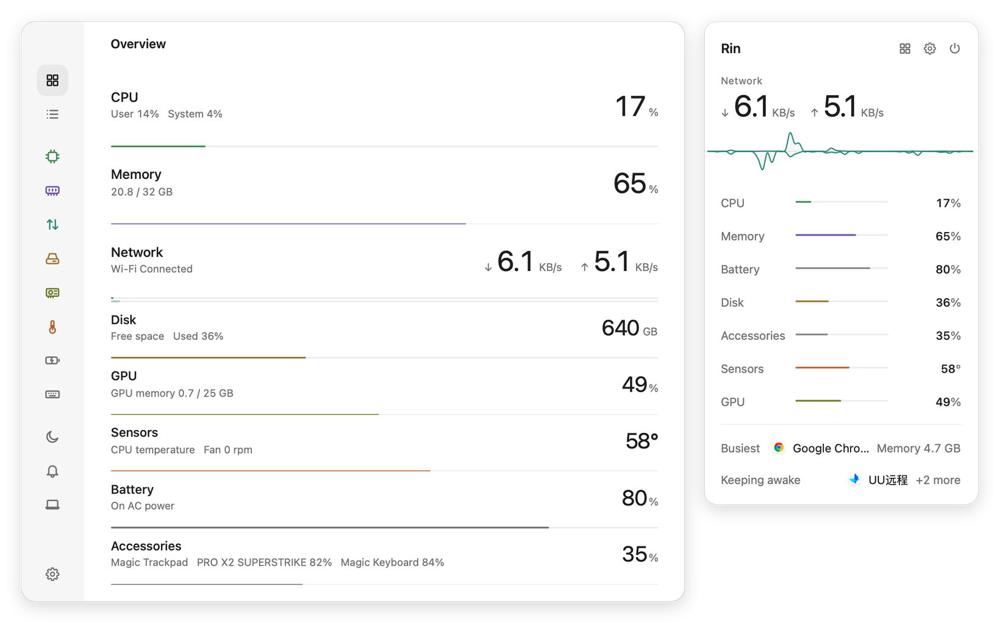
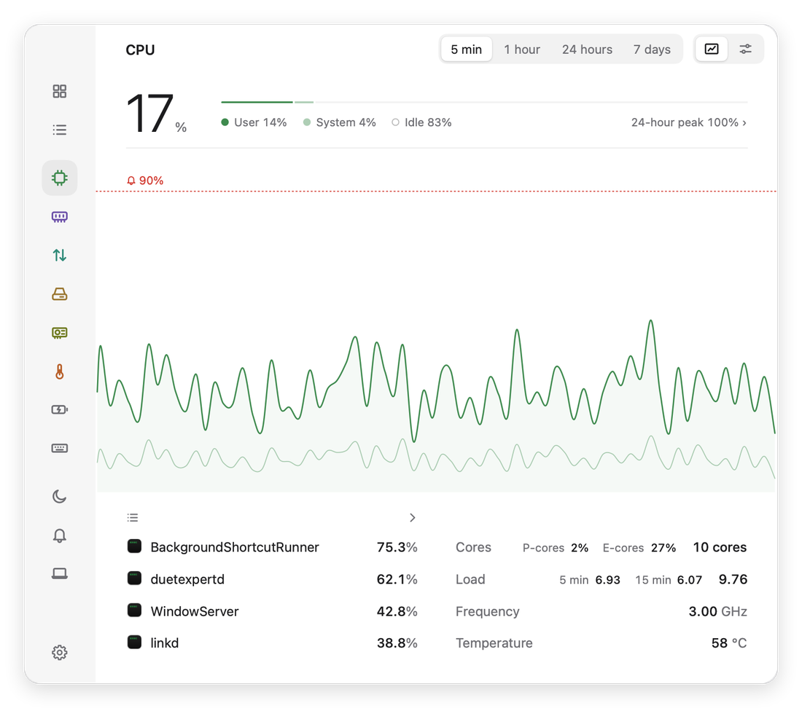
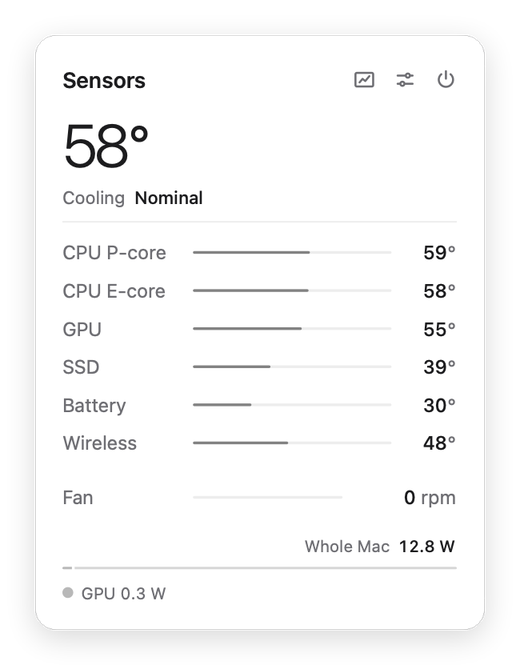

<p align="center">
  
</p>

<h1 align="center">Rin</h1>

<p align="center">A system monitor for the macOS menu bar.</p>

<p align="center">
  <a href="https://github.com/Cocojcc/Rin/releases/latest"></a>
  
  
  <a href="LICENSE"></a>
</p>

<p align="center"><b>English</b> · <a href="README.zh-CN.md">简体中文</a></p>

<p align="center">
  <picture>
    <source media="(prefers-color-scheme: dark)" srcset="docs/images/en/hero-dark.png">
    
  </picture>
</p>

Rin shows CPU, GPU, memory, network, disk, sensor, battery and accessory readings in the menu bar, with a dropdown for each module and a window for history and details. It reads a module only while something needs it, so it stays light on power.

## Contents

- [Features](#features)
- [Screenshots](#screenshots)
- [Installation](#installation)
- [Requirements](#requirements)
- [Permissions and privacy](#permissions-and-privacy)
- [Known limitations](#known-limitations)
- [Building from source](#building-from-source)
- [Contributing](#contributing)
- [License](#license)

## Features

### Modules

| Module | Readings |
|---|---|
| CPU | Total, user and system load; performance and efficiency core averages; frequency; temperature; load average |
| Memory | Usage, pressure, swap, and a breakdown into app, wired, compressed, cached and free memory |
| Network | Download and upload speed, session and daily totals, latency, local and router addresses, per-app traffic |
| Disk | Free space per volume, read and write speed, per-app activity, S.M.A.R.T. health of the internal SSD |
| GPU | Usage, memory, frequency, temperature and power |
| Sensors | Temperatures by component, fan speed, thermal state, system power |
| Battery | Level, charging state, time remaining, health, cycle count, power draw, UPS status |
| Accessories | Battery level of Bluetooth devices and of devices on Logitech wireless receivers |

### Menu bar

- One item per module, or a single merged item
- Widgets you combine per module: graphs, bars, rings, values and icons
- A dropdown for each module, and a combined dropdown that lists them all
- Optional animated characters, with support for importing your own

### Main window

- **Overview:** every module on one list
- **Module pages:** history over 5 minutes, 1 hour, 24 hours and 7 days
- **Processes:** a searchable table with details and quit actions
- **Alerts:** rules for each module, with notifications and a log of recent alerts
- **Sleep:** keep the Mac awake on a timer, and see what is preventing sleep
- **About This Mac:** model, chip, memory and storage

Rin follows the system's light or dark appearance, or can be set to either, and is available in English and Simplified Chinese.

## Screenshots

<table>
  <tr>
    <td width="66%">
      <picture>
        <source media="(prefers-color-scheme: dark)" srcset="docs/images/en/cpu-dark.png">
        
      </picture>
    </td>
    <td width="34%">
      <picture>
        <source media="(prefers-color-scheme: dark)" srcset="docs/images/en/sensors-dark.png">
        
      </picture>
    </td>
  </tr>
</table>

## Installation

1. Download `Rin-<version>.dmg` from the [latest release](https://github.com/Cocojcc/Rin/releases/latest).
2. Open the disk image and drag Rin to Applications.
3. Open Rin. It runs from the menu bar; open the main window from any dropdown.

Releases are signed with a Developer ID and notarized by Apple. Each release lists the SHA-256 checksum of its disk image, which you can compare with:

```bash
shasum -a 256 Rin-<version>.dmg
```

Rin does not update itself. To update, download the newer disk image and replace the app.

### Uninstalling

Quit Rin and move it to the Trash. To remove its settings and history as well:

```bash
defaults delete com.zoro.rin
```

```bash
rm -r ~/Library/Application\ Support/Rin
```

## Requirements

- macOS 14 Sonoma or later
- A Mac with Apple silicon

Rin is developed and tested on macOS 27. Earlier supported versions receive less testing.

## Permissions and privacy

Rin has no account, analytics or telemetry. Its settings and history stay on your Mac, in the app's preferences and `~/Library/Application Support/Rin`.

Rin makes two kinds of network request, and you can turn off both:

| Purpose | Destination | When | Setting |
|---|---|---|---|
| Latency | ICMP echo to `1.1.1.1` | Every 30 seconds while the Network module is running | On by default |
| Public IP address | HTTPS to `api.ipify.org` | Every 10 minutes, and when the connection changes | Off by default |

Rin is not sandboxed, which is why it is not on the Mac App Store. It reads hardware through IOKit, the SMC and IOReport, and runs the system tools `ps`, `top`, `nettop` and `system_profiler`.

Other things you may notice:

- Rin asks for notification permission so that alerts can reach you.
- Quitting a process from the Processes page sends it a real quit or kill.
- The optional menu bar icon spacing preset changes a system-wide setting and restarts Control Center and the system menu bar.

## Known limitations

- Intel Macs are not supported.
- Some readings use undocumented macOS interfaces, which a macOS update may change.
- iPhone and iPad battery levels are not available.
- Video encoders and decoders report power only, not usage.
- Per-app energy covers CPU energy only, and not other users' processes.

## Building from source

You need Xcode 27 and [XcodeGen](https://github.com/yonaskolb/XcodeGen).

```bash
brew install xcodegen
```

```bash
xcodegen generate
```

```bash
xcodebuild -project Rin.xcodeproj -scheme Rin -configuration Release -derivedDataPath build/DerivedData build
```

```bash
open build/DerivedData/Build/Products/Release/Rin.app
```

Local builds are signed ad hoc and are not notarized.

## Contributing

Bug reports and pull requests are welcome. See [CONTRIBUTING.md](CONTRIBUTING.md) for the project layout and conventions, and [CHANGELOG.md](CHANGELOG.md) for the release history.

## License

Rin is released under the [MIT License](LICENSE).
