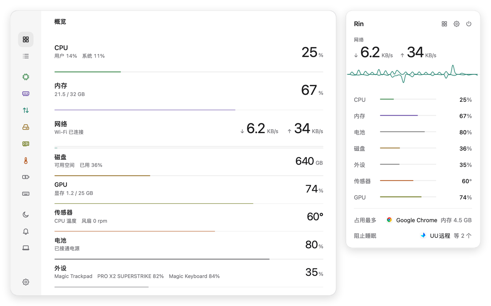
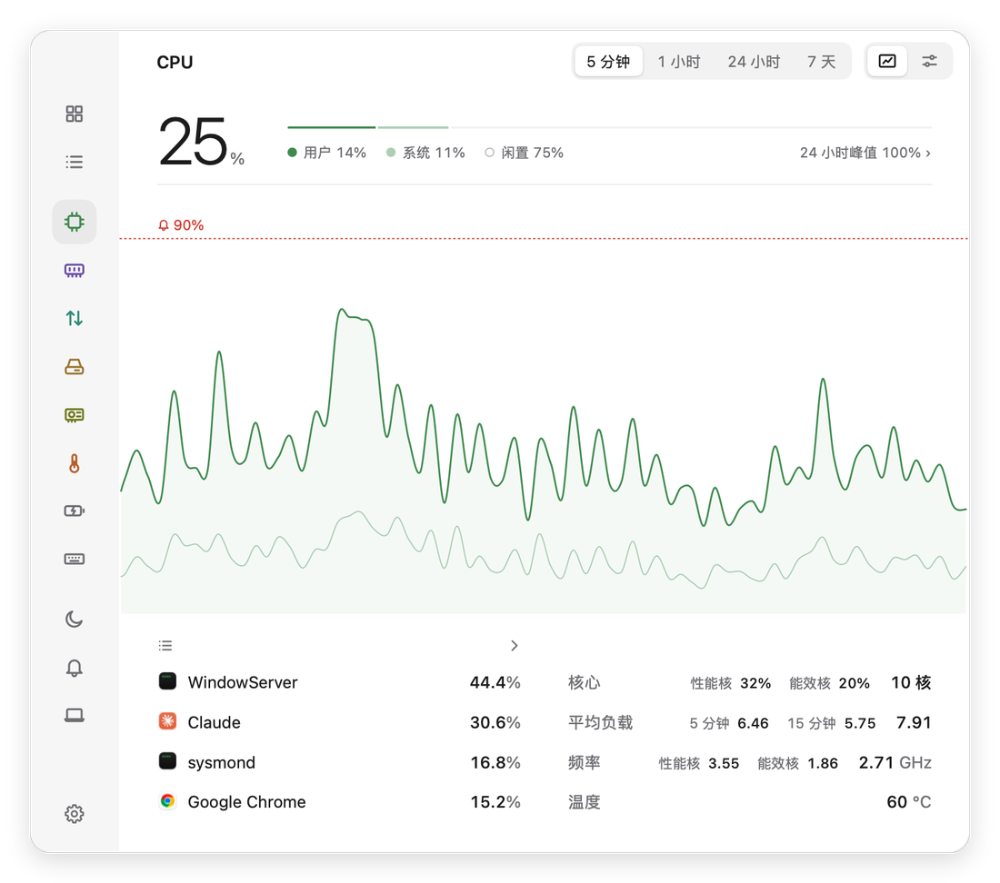
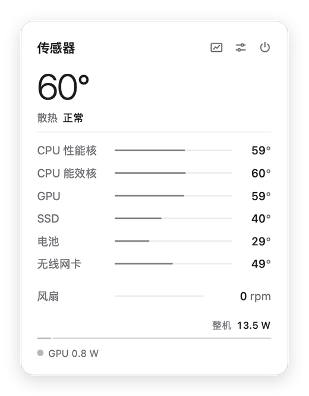

<p align="center">
  
</p>

<h1 align="center">Rin</h1>

<p align="center">macOS 菜单栏系统监控工具。</p>

<p align="center">
  <a href="https://github.com/Cocojcc/Rin/releases/latest"></a>
  
  
  <a href="LICENSE"></a>
</p>

<p align="center"><a href="README.md">English</a> · <b>简体中文</b></p>

<p align="center">
  <picture>
    <source media="(prefers-color-scheme: dark)" srcset="docs/images/zh/hero-dark.png">
    
  </picture>
</p>

Rin（凛）在菜单栏显示 CPU、GPU、内存、网络、磁盘、传感器、电池和外设的读数。每个模块有自己的下拉面板，主窗口用于查看历史和详情。Rin 只在需要时才读取模块数据，因此耗电很少。

## 目录

- [功能](#功能)
- [截图](#截图)
- [安装](#安装)
- [系统要求](#系统要求)
- [权限与隐私](#权限与隐私)
- [已知限制](#已知限制)
- [从源码构建](#从源码构建)
- [参与贡献](#参与贡献)
- [许可证](#许可证)

## 功能

### 模块

| 模块 | 读数 |
|---|---|
| CPU | 总占用、用户和系统占用、性能核和能效核平均占用、频率、温度、平均负载 |
| 内存 | 使用量、内存压力、交换，以及 App、联动、已压缩、缓存和可用内存的构成 |
| 网络 | 下载和上传速度、本次和当日流量、延迟、本机和路由器地址、各 App 流量 |
| 磁盘 | 各宗卷可用空间、读写速度、各 App 读写、内置固态硬盘的 S.M.A.R.T. 健康状态 |
| GPU | 使用率、显存、频率、温度和功耗 |
| 传感器 | 各部件温度、风扇转速、散热状态、整机功耗 |
| 电池 | 电量、充电状态、剩余时间、健康度、循环次数、功耗、UPS 状态 |
| 外设 | 蓝牙设备和罗技无线接收器所连设备的电量 |

### 菜单栏

- 每个模块一项，或合并成一项
- 按模块自由组合小组件：曲线、柱状图、圆环、数值和图标
- 每个模块有自己的下拉面板，合并下拉面板列出全部模块
- 可选的动画角色，也可以导入自己的角色

### 主窗口

- **概览：** 用一个列表显示全部模块
- **模块页：** 可查看 5 分钟、1 小时、24 小时和 7 天的历史
- **进程：** 可搜索的进程表，提供详情和退出操作
- **提醒：** 各模块的提醒规则、系统通知和最近触发记录
- **睡眠：** 定时保持 Mac 唤醒，并查看正在阻止睡眠的项目
- **关于本机：** 机型、芯片、内存和存储

Rin 可以跟随系统外观，也可以固定为浅色或深色，并提供简体中文和英文界面。

## 截图

<table>
  <tr>
    <td width="66%">
      <picture>
        <source media="(prefers-color-scheme: dark)" srcset="docs/images/zh/cpu-dark.png">
        
      </picture>
    </td>
    <td width="34%">
      <picture>
        <source media="(prefers-color-scheme: dark)" srcset="docs/images/zh/sensors-dark.png">
        
      </picture>
    </td>
  </tr>
</table>

## 安装

1. 从[最新版本](https://github.com/Cocojcc/Rin/releases/latest)下载 `Rin-<版本>.dmg`。
2. 打开磁盘映像，把 Rin 拖到「应用程序」。
3. 打开 Rin。它运行在菜单栏，可以从任意下拉面板打开主窗口。

发布版本已使用 Developer ID 签名并通过 Apple 公证。每个版本都列出了磁盘映像的 SHA-256 校验值，可以用下面的命令核对：

```bash
shasum -a 256 Rin-<版本>.dmg
```

Rin 不会自动更新。更新时请下载新版磁盘映像并替换应用。

### 卸载

退出 Rin 并把它移到废纸篓。如果要同时删除设置和历史记录：

```bash
defaults delete com.zoro.rin
```

```bash
rm -r ~/Library/Application\ Support/Rin
```

## 系统要求

- macOS 14 Sonoma 或更新版本
- 搭载 Apple 芯片的 Mac

Rin 在 macOS 27 上开发和测试，对较早的受支持版本测试较少。

## 权限与隐私

Rin 不需要账户，也没有分析或遥测功能。设置和历史记录都保存在你的 Mac 上，位于应用偏好设置和 `~/Library/Application Support/Rin`。

Rin 会发出两种网络请求，都可以关闭：

| 用途 | 目标 | 时机 | 设置 |
|---|---|---|---|
| 延迟 | 向 `1.1.1.1` 发送 ICMP 回显 | 网络模块运行时每 30 秒一次 | 默认开启 |
| 公网 IP 地址 | 通过 HTTPS 访问 `api.ipify.org` | 每 10 分钟一次，连接变化时也会请求 | 默认关闭 |

Rin 没有使用沙盒，因此不在 Mac App Store 上架。它通过 IOKit、SMC 和 IOReport 读取硬件信息，并会运行系统工具 `ps`、`top`、`nettop` 和 `system_profiler`。

其他需要了解的行为：

- Rin 会请求通知权限，用于发送提醒。
- 在进程页退出进程时，Rin 会真实地结束该进程。
- 可选的「所有菜单栏图标间距」预设会修改系统级设置，并重启控制中心和系统菜单栏。

## 已知限制

- 不支持 Intel Mac。
- 部分读数依赖未公开的 macOS 接口，系统更新后可能发生变化。
- 无法读取 iPhone 和 iPad 的电量。
- 视频编解码器只能读取功耗，无法读取使用率。
- 各 App 的能耗只包含 CPU 能耗，也不包含其他用户的进程。

## 从源码构建

需要 Xcode 27 和 [XcodeGen](https://github.com/yonaskolb/XcodeGen)。

```bash
brew install xcodegen
```

```bash
xcodegen generate
```

```bash
xcodebuild -project Rin.xcodeproj -scheme Rin -configuration Release -derivedDataPath build/DerivedData build
```

```bash
open build/DerivedData/Build/Products/Release/Rin.app
```

本地构建使用临时签名，未经公证。

## 参与贡献

欢迎提交问题报告和 Pull Request。项目结构和约定见 [CONTRIBUTING.md](CONTRIBUTING.md)，版本历史见 [CHANGELOG.md](CHANGELOG.md)。这两份文档目前只有英文版。

## 许可证

Rin 基于 [MIT 许可证](LICENSE)发布。
